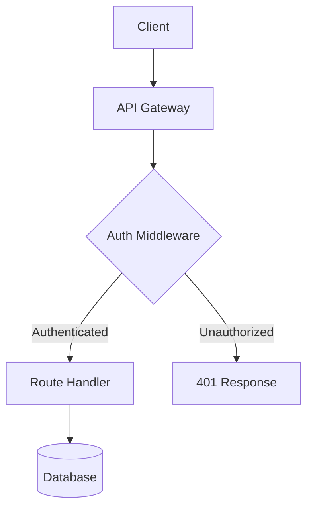

# User Auth System

## Overview

Sign-in with email and password, sessions as short-lived JWTs with rotating
refresh tokens, and a lockout after repeated failures. The research is in
[research-01](research-01.md) and [the second round](./research-02.md); what the
owner said is in [the interview](interview-01.md). It waits on the
[API refactor](../api-refactor/SPEC.md), and the [page audit](page-audit.md#findings)
lists what the login page lacks.

## Acceptance Criteria

- [x] `POST /auth/login` returns 200 and a token pair for a valid user
- [x] A wrong password returns 401 with an error body
- [ ] Five failures in ten minutes lock the account for fifteen
- [ ] [NEEDS CLARIFICATION] Whether a locked account may still reset its password

## Architecture

### System Diagram

```
Client → API Gateway → Auth Middleware → Route Handler → Database
                                            ↓
                                       Cache Layer
```



A diagram the chief got wrong, kept to show what a broken one looks like:

```mermaid
graph TD
    A[Client] -->|no closing --> B{{Gateway
```

## Library Choices

| Need | Library | Version | Alternatives Considered | Rationale |
|------|---------|---------|------------------------|-----------|
| Hashing | argon2 | 0.5 | bcrypt, scrypt | Memory-hard, OWASP's first pick |
| Tokens | `jsonwebtoken` | 9 | paseto | The team knows it |

## Phase 1: Tokens [completed]

- [x] [AUTH-01] Generate access tokens in `src/auth/tokens.ts`
- [x] [AUTH-02] Generate refresh tokens
- [x] [AUTH-03] Verify a token's signature and expiry

## Phase 2: Login [in-progress]

- [x] [AUTH-04] `POST /auth/login`
- [x] [AUTH-05] Hash passwords with argon2
- [ ] [AUTH-06] Lock out after repeated failures ← current
  - [x] count failures per account
  - [ ] unlock after fifteen minutes
    1. store the lock's end
    2. check it on each attempt
- [ ] [AUTH-07] Rotate refresh tokens on each use

## Phase 3: Hardening [pending]

- [ ] [AUTH-08] Rate-limit `/auth/*`
- [ ] [AUTH-09] Audit log of sign-ins
- [ ] [AUTH-10] Session list and revoke
- [ ] [AUTH-11] Password reset by email
- [ ] [AUTH-12] Load test with 1000 sign-ins a second

## Testing Strategy

### Unit Tests
- `tests/unit/tokens.test.ts` — signing, expiry and rotation
- Framework: Vitest

---

## Resume Context

> Lockout counting works in `src/auth/lockout.ts`; the unlock is not written.
> Next: store the lock's end in `lockouts.until` and check it in
> `POST /auth/login` before the password.

## Decision Log

| Date | Decision | Rationale |
|------|----------|-----------|
| 2026-10-03 | JWT over sessions | Stateless auth scales across the API's instances |
| 2026-10-05 | Refresh token rotation | Limits the window if a token is stolen |

## Deviations

| Task | Spec Said | Actually Did | Why |
|------|-----------|-------------|-----|
| AUTH-05 | bcrypt | argon2 | The research found bcrypt's 72-byte limit |

See also [the strategy](strategy-api-v1.md), [the notes](artifacts/notes.md),
[the flow](flow.png), [a page outside](https://example.com/auth) and
[a file outside the folder](../../package.json).
