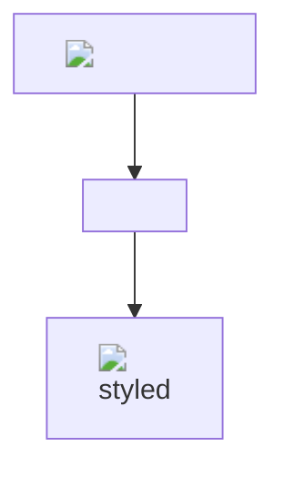
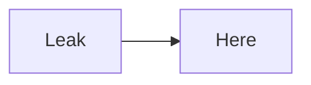
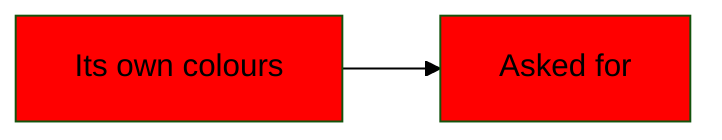

# Evil 

<iframe src="javascript:window.__pwned='iframe'"></iframe>

A [script link](javascript:window.__pwned='link'), a [data link](data:text/html,),
a [link out of the folder](../../../etc/passwd), an [absolute one](/etc/passwd), a
[protocol-relative one](//evil.example/x) and an image .

- [x]  a done task
- [ ] **<svg onload="window.__pwned='svg'">** an open one

|  | `` |
|---|---|
| [x](javascript:window.__pwned='cell-link') | <a href="javascript:void(0)">raw</a> |

