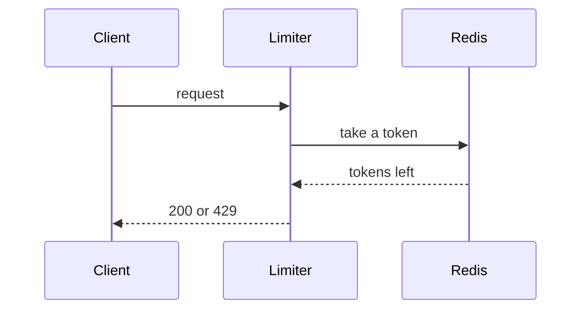

# Rate Limiter

## Overview

A token bucket per API key, in Redis, that answers 429 with `Retry-After`.

## Acceptance Criteria

- [x] A key over its rate gets 429 with `Retry-After`
- [ ] Buckets refill at the key's rate

## Architecture

## Phase 1: Bucket [in-progress]

- [x] [TEST-RL-01] Write tests for taking a token
- [x] [IMPL-RL-02] Implement taking a token -> satisfies [TEST-RL-01]
- [ ] [TEST-RL-03] Write tests for the refill <- current
- [ ] [IMPL-RL-04] Implement the refill -> satisfies [TEST-RL-03]

## Phase 2: Middleware [pending]

- [ ] [TEST-RL-05] Write tests for the 429 answer
- [ ] [IMPL-RL-06] Implement the middleware -> satisfies [TEST-RL-05]

## Test Log

| Task | RED | GREEN | REFACTOR |
|------|-----|-------|----------|
| [TEST-RL-01] | `Expected: 0, Received: undefined` | — | — |
| [IMPL-RL-02] | — | `4 passed, 0 failed` | Extracted `takeToken()` |

---

## Resume Context

> - TDD Phase: RED
> - Failing Tests: `refill.test.ts` (2)
> - Next: write the refill tests' third case, a bucket already full.
